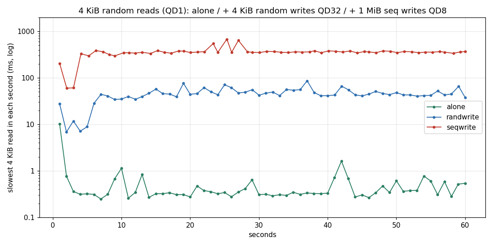

@@STYLE@@

# 13. 읽기와 쓰기의 간섭 : 쓰기가 돌면 읽기는 얼마나 기다리나

<div class="glance">
<b>목표</b><span>4 KiB 읽기 (QD1) 의 지연을 혼자일 때, 순차 쓰기와 함께일 때, 랜덤 쓰기 (GC 가 도는) 와 함께일 때 재서, 꼬리 지연이 얼마나 길어지는지 본다</span>
<b>보는 FTL 개념</b><span>NAND 의 프로그램 · 지우기 시간, die 를 차지하는 동안의 읽기 대기, GC 와 꼬리 지연, (더 좋은 드라이브의) program/erase suspend</span>
<b>지우나?</b><span>예</span>
<b>연결</b><span>SATA</span>
<b>시간</b><span>약 30분 (채우기 13분 + 사전 쓰기 10분 + 측정 3 × 2분)</span>
<b>명령</b><span><code>sudo ./lab.sh mixed</code></span>
</div>

## 배경

NAND die 하나는 한 번에 한 가지 일만 한다. TLC 의 프로그램 (쓰기) 은 ms 단위, 블록 지우기는 그보다 길다. 그동안 **같은 die 에 있는 데이터를 읽으려는 요청은 기다린다.**
그래서 읽기만 할 때는 100 µs 근처이던 지연이, 쓰기가 섞이면 가끔 수 ms – 수십 ms 가 된다. 평균은 조금만 늘어도 99.9% 는 크게 는다. 데이터베이스 · 웹 서버가 SSD 의 '꼬리 지연' 을 따지는 이유다.

[fio 페이지 8절](/old-ssd-experiments/fio/) 에서 이 컴퓨터의 NVMe 로 같은 시험을 미리 해 봤다 : 혼자일 때 99.9% = 186 µs, 순차 쓰기와 함께일 때 11,207 µs (60배).

## 가설과 예상

```table
가설 | 맞다면 보일 것
H1 순차 쓰기가 읽기의 꼬리를 늘린다 | `seqwrite` 의 읽기 99.9% 가 `alone` 의 10배 이상
H2 GC 가 도는 랜덤 쓰기는 더 나쁘다 | `randwrite` 의 읽기 99.9% · max 가 `seqwrite` 보다도 길다 (GC 의 복사 · 지우기가 더해진다)
H3 50% 지연은 덜 늘어난다 | 중앙값은 2–3배 안 : 대부분의 읽기는 바쁜 die 에 걸리지 않는다
H4 1초마다의 최대 지연이 출렁인다 | `*-rd_lat.log` (1초마다 가장 느린 읽기) 그래프에 GC 의 리듬이 보인다
```

## 절차

```
$ sudo ./lab.sh mixed
```

```table
단계 | 하는 일
1 | 전체 TRIM, 1 MiB 순차로 전체를 채움 (읽기가 진짜 NAND 를 읽게)
2 | 4 KiB 랜덤 쓰기 QD32 를 10분 (GC 가 일하는 상태로)
3 | `alone` : 4 KiB 랜덤 읽기 QD1, 60초
4 | `seqwrite` : 같은 읽기 + 다른 job 이 뒤쪽 절반에 1 MiB 순차 쓰기 QD8
5 | `randwrite` : 같은 읽기 + 다른 job 이 4 KiB 랜덤 쓰기 QD32 (전체 범위)
```

각 측정 사이에 60초 쉰다. 읽기 job 은 1초마다 **가장 느렸던 읽기** 를 기록한다 (`--log_max_value=1`).

## 결과 읽는 법

```
$ D=$(ls -d ~/Ryu/old_ssd_results/*-mixed | tail -1)
$ column -s, -t $D/summary.csv
$ python3 plot.py mixed.png $D/alone-rd_lat.log=alone $D/seqwrite-rd_lat.log=seqwrite $D/randwrite-rd_lat.log=randwrite
```

1. `summary.csv` 의 `rd` 줄 세 개 : IOPS, 50%, 99%, 99.9%, max.
2. 그림 : 1초마다의 최대 지연. 쓰기의 IOPS (`wr` 줄) 와 함께 보면 '쓰기 속도를 얻은 대신 읽기 지연을 얼마나 냈나' 가 보인다.
3. 비교 : 실험 5 의 `randread-4k-qd1` 칸 (쓰기 없음, 깨끗한 상태) 과 `alone` 이 같은지. 다르면 GC 가 쉬는 동안에도 남아 있던 일이 읽기를 방해한 것이다.

## 결과

<div class="result" markdown="1">
2026.11.01 08:23 – 08:54 (31분), 결과 폴더 `20261101-082332-mixed`. 실험 11 의 uniform 채우기 (10.28) 뒤 처음 실행 : TRIM → 1 MiB 순차로 전체 채우기 (약 144 MB/s) → 4 KiB 랜덤 쓰기 10분 (처음 1분 약 3.5만 IOPS, 그 뒤 약 2.3천 → 3천).



```table
경우 | 읽기 IOPS | 읽기 평균 | 50% | 99% | 99.9% | max | 함께 돈 쓰기
`alone` | 7,350 | 124 µs | 120 µs | 171 µs | 216 µs | 10.2 ms | 없음
`randwrite` | 232 | **4.29 ms** | 602 µs | 38.5 ms | 54.3 ms | 86.6 ms | 4 KiB QD32 : 7,586 IOPS (31.1 MB/s), 평균 **4.21 ms**
`seqwrite` | **5** | **207 ms** | 300 ms | 549 ms | 684 ms | 680 ms | 1 MiB QD8 : 42.1 MB/s, 평균 **199 ms**
```

**`alone` 은 실험 5 와 같다.** 실험 5 의 `randread-4k-qd1` (7,043 IOPS, 50% 122 µs) 과 거의 같은 값이다. 1초마다의 최대도 대개 0.3 – 1.6 ms. 다만 **첫 1초의 max 10.2 ms** 는 바로 앞의 10분 랜덤 쓰기가 남긴 일 (GC 또는 버퍼 비우기) 이 아직 돌던 흔적으로 보인다.

**H1 (순차 쓰기가 읽기의 꼬리를 늘린다) : 맞다, 예상보다 훨씬 크게.** 99.9% 가 216 µs → 684 ms, **약 3,000배** (10배 이상을 예상). 1분 동안 읽기를 겨우 약 300번 했다 (5 IOPS). [fio 페이지 8절](/old-ssd-experiments/fio/) 의 NVMe (60배) 와 비교도 안 된다.

**H2 (GC 가 도는 랜덤 쓰기가 더 나쁘다) : 아니다, 반대.** 랜덤 4 KiB 쓰기와 함께일 때의 읽기 평균은 4.3 ms, 1 MiB 순차 쓰기와 함께일 때는 207 ms 로 **순차 쪽이 약 50배 나쁘다.**

**H3 (중앙값은 2 – 3배 안) : 아니다.** 중앙값도 5배 (randwrite) , 2,500배 (seqwrite). '가끔 바쁜 die 에 걸리는' 읽기만 느린 게 아니라, **모든 읽기가 느리다.**

**H4 (1초마다의 최대가 GC 의 리듬으로 출렁인다) : 아니다.** 두 경우 모두 처음 몇 초만 낮고 (아래), 그 뒤는 거의 평평한 고원 (randwrite 약 45 ms, seqwrite 약 350 ms) 이다. 출렁임이 아니라 '늘 일정하게 기다린다' 는 모양.

### 왜 : 읽기는 앞에 쌓인 쓰기를 다 기다린다

표의 굵은 숫자를 보면 **읽기의 평균 지연 ≈ 쓰기의 평균 지연** 이다 (4.29 대 4.21 ms, 207 대 199 ms). 읽기가 따로 빨리 처리되지 않고, 드라이브 안의 줄 (SATA NCQ, 32칸) 에서 **이미 들어와 있는 쓰기를 차례로 기다린다** 는 뜻이다. 그러면 기다리는 시간은 Little 의 법칙대로 '앞에 쌓인 양 ÷ 처리 속도' 다 :

```table
경우 | 앞에 쌓인 쓰기 | 쓰기 속도 | 쌓인 양 ÷ 속도 | 잰 읽기 평균
randwrite | 32 × 4 KiB = 128 KiB | 31.1 MB/s | **4.2 ms** | 4.29 ms
seqwrite | 8 × 1 MiB = 8 MiB | 42.1 MB/s | **199 ms** | 207 ms
```

두 경우의 쓰기 속도 (31 대 42 MB/s) 는 비슷하다. 차이는 **줄에 서 있는 바이트 수가 64배** 라는 것뿐이다. 그래서 순차 쓰기가 '착한' 쓰기라는 생각은 여기서는 틀린다 : 읽기 쪽에서 보면 쓰기의 패턴이 아니라 **앞에 쌓인 바이트 수** 가 지연을 정한다.
리눅스의 I/O 스케줄러 (`mq-deadline`, 읽기를 먼저 보내려 한다) 도 소용없다 : 명령이 한번 드라이브의 NCQ 에 들어가면 순서는 드라이브가 정하고, 이 드라이브는 읽기를 앞세우지 않는 것으로 보인다 (program/erase suspend 같은 것이 없거나 거의 안 쓴다).

### 쓰기 속도도 느리다

- 순차 1 MiB 쓰기가 **42 MB/s** : 빈 드라이브를 채울 때 (약 144 MB/s, 실험 12 의 약 151 MB/s) 의 3분의 1 이하. 바로 앞의 10분 랜덤 쓰기가 데이터를 블록마다 흩어 놓아서, 순차로 덮어써도 빈 블록을 만들려면 GC 가 유효 데이터를 옮겨야 한다.
- 랜덤 4 KiB 쓰기는 평균 7,586 IOPS 로, 사전 쓰기의 끝 (약 3천) 보다 높다. 그래프에서 처음 약 5초는 읽기 max 가 7 – 11 ms 로 낮다 : 60초 쉬는 동안 SLC 버퍼가 비어서 ([실험 9](/old-ssd-experiments/9-idle-gc/)) 처음 몇 GB 를 빠르게 받은 것으로 보인다 (쓰기 쪽 1초 기록이 없어 추정). seqwrite 의 처음 3초 (약 60 ms) 도 같은 이유로 보인다.

### 실제로 쓸 데

- 이 드라이브에서 큰 파일 복사 같은 **큰 순차 쓰기가 돌면, 다른 프로그램의 작은 읽기가 수백 ms 씩 멈춘다.** 옛 PC 가 '복사 중에 버벅이던' 이유 중 하나.
- 읽기를 지키려면 쓰기 쪽의 **깊이 × 크기** 를 줄인다 : 예를 들어 같은 42 MB/s 라도 1 MiB × QD1 이면 기다림은 약 25 ms (8분의 1) 로 계산된다. 커널에서는 `nr_requests` · `max_sectors_kb` 를 낮추거나, BFQ · `io.latency` 같은 cgroup 제어를 쓴다. (이번에는 재지 않았다.)
- 꼬리 지연을 따지는 서버용 드라이브가 program/erase suspend, 읽기 우선 스케줄링을 넣는 이유를 이 결과가 거꾸로 보여 준다.
</div>

@@NAV@@
