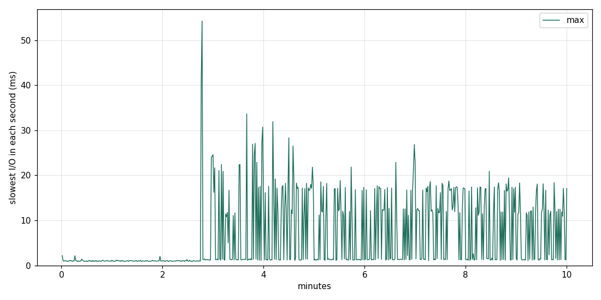
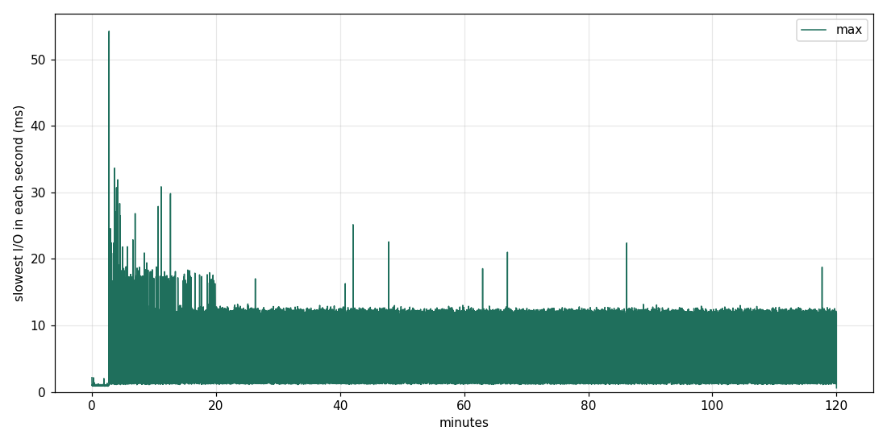

@@STYLE@@

# 15. Read disturb : 같은 곳을 수억 번 읽으면

<div class="glance">
<b>목표</b><span>드라이브를 검사 가능한 무늬로 채운 뒤, 맨 앞 1 MiB 만 몇 시간 동안 계속 읽는다. 펌웨어가 그 블록을 옮기는 순간 (지연이 튀는 곳) 이 보이는지, 이웃 데이터가 상했는지 확인한다</span>
<b>보는 FTL 개념</b><span>read disturb (읽기 전압이 이웃 셀을 조금씩 프로그램함), 읽기 횟수 세기, read reclaim (블록 옮기기), ECC</span>
<b>지우나?</b><span>예</span>
<b>연결</b><span>SATA</span>
<b>시간</b><span>실제 2시간 38분 : 채우기 33분 + 두드리기 2시간 + 확인 5분 (기본값 6시간은 쓰지 않았다)</span>
<b>명령</b><span><code>sudo ./lab.sh disturb 2</code></span>
</div>

## 배경

NAND 에서 한 페이지를 읽으려면 같은 블록의 **다른 모든 줄 (word line)** 에 높은 '통과 전압' 을 건다. 이 전압이 그 줄들의 셀에 전자를 아주 조금씩 밀어 넣는다. 한두 번은 아무 일도 없지만, 같은 블록을 수만–수십만 번 읽으면 이웃 셀의 전압이 올라가 비트 오류가 생긴다 : **read disturb**.
그래서 FTL 은 블록마다 읽은 횟수를 세고, 한도를 넘으면 그 블록의 데이터를 새 블록으로 옮긴다 (read reclaim). 그 순간 그 블록을 읽는 요청은 기다린다.

```table
이 실험에서 | 크기
두드리는 영역 | 맨 앞 1 MiB (4 KiB × 256개). TLC 블록 하나 (수 MiB 로 짐작) 안이거나 두세 개에 걸친다
읽기 속도 | QD32 4 KiB 랜덤 읽기 : 수만 IOPS
6시간 동안 | 수억 번 읽기 → 블록 하나가 수억 번 읽힌다 (흔히 말하는 한도 : 수만–수십만 번)
```

## 가설과 예상

```table
가설 | 맞다면 보일 것
H1 펌웨어가 읽기 횟수를 세어 블록을 옮긴다 | `hammer_lat.log` (1초마다 가장 느린 읽기) 에 주기적인 큰 튐 : 옮기는 동안의 대기. 튀는 간격 = 읽기 한도 ÷ IOPS
H2 옮기기 덕분에 데이터는 상하지 않는다 | verify 의 나쁜 블록 = 0
H3 옮기기 전까지는 이웃이 조금씩 나빠진다 | `near-after` 의 지연 (앞 1 GiB) 이 `near-before` 보다 길거나, SMART 195 (ECC 로 고친 오류) 가 는다
H4 컨트롤러가 읽기를 RAM 에 담아 둔다면 | IOPS 가 SATA 한계 (약 10만) 근처이고 지연이 아주 짧고 고르다 : NAND 를 안 읽는다 (그러면 이 실험은 다른 방법이 필요하다)
```

## 절차

```
$ sudo ./lab.sh disturb 2        # 숫자 = 두드릴 시간 (시간 단위)
```

```table
단계 | 하는 일
1 | 전체를 1 MiB 순차로 쓰되 4 KiB 마다 crc32c 머리말 (실험 16 과 같은 무늬)
2 | `near-before` : 앞 1 GiB 안의 4 KiB 랜덤 읽기 QD1, 60초
3 | SMART 기록
4 | `hammer` : 앞 1 MiB 만 4 KiB 랜덤 읽기 QD32, HOURS 시간. 1초마다 IOPS 와 가장 느린 읽기 기록
5 | SMART 기록, `near-after` (2 와 같은 측정)
6 | 전체 verify : 모든 4 KiB 블록의 체크섬 → `verify-summary.txt`
```

## 결과 읽는 법

```
$ D=$(ls -d ~/Ryu/old_ssd_results/*-disturb-* | tail -1)
$ python3 plot.py hammer-lat.png $D/hammer_lat.log=max
$ python3 plot.py hammer-iops.png $D/hammer_iops.log
$ cat $D/verify-summary.txt; python3 smartdiff.py $D
$ column -s, -t $D/summary.csv
```

1. **튐의 간격** : 두 튐 사이의 시간 × 평균 IOPS ÷ (1 MiB 가 걸친 블록 수) ≈ 펌웨어의 읽기 한도. Claude 가 로그에서 튐을 찾아 계산한다.
2. **verify** : 0 이 아니면 read disturb 로 상한 데이터를 ECC 도 펌웨어도 막지 못한 것이다.
3. **near-before / after** 의 50% · 99% 지연.

## 결과

<div class="result" markdown="1">
2026.11.07 12:32 – 15:10 (2시간 38분), 결과 폴더 `20261107-123221-disturb-2h`. `sudo ./lab.sh disturb 2` : 6시간 대신 2시간 두드렸다.

```table
단계 | 시각 | 결과
쓰기 (crc32c 무늬) | 12:32 – 13:05 | 33분, 평균 약 61 MB/s
`near-before` | 13:05 | 8,766 IOPS, 50% 105 µs
`hammer` | 13:06 – 15:06 | **5.66억 번** 읽기 (2.3 TB), 평균 78,652 IOPS. 4 KiB 하나당 약 221만 번
`near-after` | 15:06 | 8,324 IOPS, 50% 107 µs
verify | 15:07 – 15:10 | 약 525 MiB/s 로 전체 읽기, **나쁜 블록 0**
```

### 2분 46초에 드라이브가 바뀌었다

예상은 '주기적인 큰 튐' 이었다. 실제 모습은 달랐다. 처음 165초는 완전히 고르다가, **1,465만 번째 읽기쯤에서 상태가 한 번 바뀌고 돌아오지 않았다.**



```table
구간 | IOPS | 1초마다 가장 느린 읽기
0 – 165초 | 약 88,800 | 약 1.0 ms 로 평평
166 – 167초 | **42,113 → 13,945** | **41 – 54 ms**
168초 – 약 20분 | 약 79,000 | 약 1.3 ms 또는 12 – 30 ms
약 20분 – 끝 | 약 78,400 | 1 – 2 ms 또는 **약 11 – 12 ms**
```



두 가지가 **따로** 일어났다 :

1. **늘 느려졌다.** 멈춤이 없는 초에도 IOPS 는 약 79,400 으로, 처음보다 약 11% 낮다. 멈춤이 있는 초 (약 77,900) 와 2% 차이밖에 없으니, 줄어든 11% 의 대부분은 멈춤 탓이 아니다.
2. **짧게 멈추기 시작했다.** 300초 뒤 6,901초 가운데 '가장 느린 읽기' 가 1 – 2 ms 인 초가 2,487개, 10 ms 이상인 초가 4,379개 (63%), 그 사이 (2 – 10 ms) 는 34개뿐이다. 중간이 없다 : 멈춤 하나의 길이가 약 11 ms 로 정해져 있다는 뜻이다.

멈춤의 시각에는 **주기가 없다.** 1 – 40초 간격의 자기상관이 모두 0 근처, FFT 에도 두드러진 주기가 없다. 63% 라는 비율은 평균 1초에 한 번쯤 무작위로 일어나는 사건과 맞는다.

**온도는 원인이 아니다.** 드라이브는 이때 약 39 → 45 °C 로 올랐지만, 두드리기가 끝난 직후 44 °C 에서 돈 `near-after` (QD1) 의 max 는 2.1 ms 로 멈춤이 없었고, verify 도 SATA 한계 속도였다. 실험 14 의 쓰기 뒤에는 46 °C 였다. SCT 의 Over Temperature 횟수는 +28 이 늘었지만, 다른 실험에서도 시간당 비슷하게 는다.

### 가설별 판정

**H1 (펌웨어가 읽기 횟수를 세어 블록을 옮긴다) : 무언가를 세는 것은 맞아 보이지만, 옮기기라는 증거는 없다.** 165초 동안 고르다가 갑자기 바뀌었으니 시간보다 횟수 쪽이 그럴듯하고, 첫 41 – 54 ms 는 read reclaim 의 한 번 옮기기처럼 보인다. 그런데 나머지는 예상과 어긋난다 :

- 한도가 1,465만 번이라면 다음 사건은 약 3분 뒤여야 한다. 실제로는 약 1초마다 멈춘다.
- 177 은 205 그대로. 다만 177 이 +1 되려면 약 137 GB 를 써야 하므로, 블록 몇 개를 옮긴 정도로는 어차피 움직이지 않는다. 옮겼다는 증거도, 안 옮겼다는 증거도 아니다.
- 한도는 계산할 수 없다. 1 MiB 가 몇 개의 블록에 걸치는지 모르기 때문이다 (블록 1개면 1,465만 번, 8개면 약 180만 번).

**H2 (데이터는 상하지 않는다) : 맞다.** 전체 약 2,930만 개의 4 KiB 블록 가운데 나쁜 블록 0. 그리고 이 '0' 은 믿을 수 있다 : 같은 fio 옵션으로 파일에서 시험해 보니, 깨끗할 때 0, 일부러 망가뜨린 블록 2개는 정확히 2개로 잡혔다. SMART 187 · 195 도 기준선 108 그대로 ([실험 14](/old-ssd-experiments/14-secure-erase/)). 단, 2시간만 두드린 결과다.

**H3 (이웃이 조금씩 나빠진다) : 이 측정으로는 알 수 없다.** 수치로는 약간 나빠졌다 (IOPS −5%, 99% 144 → 155 µs, 99.9% 191 → 206 µs). 그러나 이것을 read disturb 의 증거로 볼 수는 없다 :

- 1초마다의 IOPS 흔들림 (`near-before` 표준편차 850, 평균의 약 10%) 이 5% 차이보다 크고, 측정은 한 번씩뿐이다.
- `near` 는 앞 1 GiB 전체를 읽으므로, 두드린 1 MiB 에 닿는 읽기는 1,024번에 1번뿐이다. 이웃을 보기에는 너무 넓다.
- **195 는 쓸모가 없었다.** 이 드라이브의 195 는 지금까지 늘 187 과 같은 값이다 (0 → 108). 'ECC 로 고친 오류' 를 세지 않는 것으로 보이므로, 페이지의 예상은 틀린 지표를 골랐다.

**H4 (컨트롤러가 RAM 에 담아 둔다) : 판정 못 함.** 처음의 88,800 IOPS 는 드라이브 전체 랜덤 읽기 (실험 5 : 90,693) 와 거의 같다. 하지만 QD32 에서는 어느 쪽이든 SATA 쪽이 먼저 막히므로, 이 값으로는 NAND 를 읽었는지 알 수 없다. 이 답이 중요한 이유 : 캐시가 읽기를 받아 냈다면 NAND 가 실제로 읽힌 횟수는 5.66억 번보다 훨씬 적다.

**이 결과의 한계.** 비교할 대조군이 없다. 실험 5 의 QD32 랜덤 읽기 (max 0.84 ms) 는 20초만 돌았으므로 166초 뒤의 일을 말해 주지 못한다. '같은 곳을 읽어서' 인지 '오래 읽어서' 인지를 가르려면 드라이브 전체를 3분 넘게 읽어 봐야 한다.

### 덤 : 쓰기 속도

이번 채우기는 33분으로 실험 14 (76분) 보다 빨랐다. 처음 약 28 GiB 는 약 145 – 170 MiB/s, 중간은 36 – 56 MiB/s 로 내려갔다가 끝에서 76 MiB/s 까지 오른다. 그 전 쓰기는 지운 드라이브에 랜덤 92.8 GB 였는데, 실험 11 의 모델로는 LBA 의 약 46% 가 아직 한 번도 쓰이지 않았다 : 여유가 많아 실험 14 보다 덜 느렸을 것이다 (모델로 맞춘 것이고, 확인한 것은 아니다).

### 다음

읽기만 하는 짧은 후속 시험으로 H1 · H4 를 좁힐 수 있다 (드라이브에 지금 무늬가 남아 있다) :

```table
시험 | 시간 | 답하는 질문
앞 1 MiB, QD1, 1분 | 1분 | H4 : 약 60 µs 대면 NAND 를 안 읽는 쪽, 약 100 µs 면 NAND
다른 곳의 새 1 MiB, QD32, 5분 | 5분 | H1 : 다시 약 1,465만 번에서 바뀌면 블록마다 세는 횟수
드라이브 전체 랜덤, QD32, 5분 | 5분 | 대조군 : 멈춤이 없으면 '같은 곳을 읽어서' 가 맞다
```
</div>

@@NAV@@
