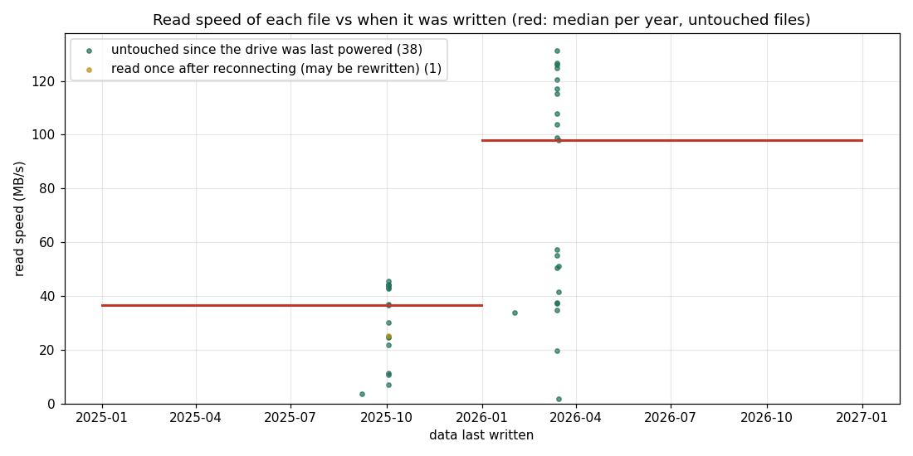

@@STYLE@@

# 20. 두 번째 드라이브 : 500GB SSD 를 읽기만 해서 보기

<div class="glance">
<b>목표</b><span>같은 계열의 두 번째 SSD (500GB) 에서 오래된 데이터의 읽기 속도를 재고, 120GB SSD (실험 1) 와 비교한다</span>
<b>보는 FTL 개념</b><span>데이터의 나이와 읽기 속도 (전하 누설 → 다시 읽기), 펌웨어의 차이</span>
<b>지우나?</b><span>아니오. 읽기만 한다 (<code>lab.sh --500gb</code> 는 check · smart · scan · oldfiles · reread 만 허용)</span>
<b>연결</b><span>USB–SATA 어댑터 (SATA 자리가 모두 차 있어서)</span>
<b>명령</b><span><code>sudo ./lab.sh --500gb check</code>, <code>sudo ./lab.sh --500gb oldfiles /mnt/old500</code>, <code>reread</code>, <code>scan old 8</code></span>
</div>

## 준비 : 아무것도 쓰지 않고 연결하기

이 실험의 값은 '오래된 데이터를 처음 읽는 순간' 에 있다. 그래서 연결할 때 드라이브에 한 바이트도 쓰지 않도록 했다.

```table
할 일 | 왜
데스크톱의 자동 마운트 끄기 (`gsettings set org.cinnamon.desktop.media-handling automount false`) | USB 디스크를 꽂으면 바로 읽기 · 쓰기로 마운트된다
파일 관리자에서 열지 않기 | 폴더를 여는 것만으로도 파일을 읽는다 (미리 보기)
`mount -o ro,noload` | ext4 는 읽기 전용 (`ro`) 이어도 저널을 되돌리느라 쓸 수 있다. `noload` 가 그것을 막는다
끝나면 자동 마운트를 다시 켜기 | `automount true`, `automount-open true`
```

확인 : 연결 뒤 `/sys/block/sdX/stat` 의 쓰기 수는 끝까지 0 이었다.

## check (2026.11.07 18:29)

결과 폴더 `20261107-182952-500gb-check`.

```table
항목 | 500GB SSD | 120GB SSD (실험 0)
펌웨어 | EXT0BB6Q | EXT0CB6Q
파일 시스템 | ext4 (파티션 1개) | NTFS (Windows)
켜져 있던 시간 | 14,713 시간 | 10,373 시간
전원을 켠 횟수 | 7,167 | 4,600
177 (평균 지우기 횟수) | 119 | 117
241 (호스트가 쓴 양) | 약 31.4 TB | 약 11.5 TB
187 · 195 (고치지 못한 오류) | 0 · 0 | 0 · 0
오류 기록 | 없음 | 없음
```

**두 드라이브는 펌웨어가 다르다.** 이 계열은 '오래된 데이터를 느리게 읽는' 문제로 펌웨어가 두 번 고쳐진 것으로 알고 있다 (확인하지 않았다). 그렇다면 이 차이가 아래의 결과 차이를 설명할 수도 있다.

한 가지 이상한 값 : `179 Used_Rsvd_Blk_Cnt_Tot` 의 WORST 가 001 (기준 010 아래) 이고 smartctl 이 `Past` 라고 표시한다. 정규화 값이 예전에 한 번 기준 아래로 내려간 적이 있다는 뜻인데, 원값 (쓴 예비 블록 수) 은 0 이다. 이유는 모른다.

## oldfiles : 파일의 나이와 읽기 속도 (2026.11.07 18:37)

결과 폴더 `20261107-183746-500gb-oldfiles`. 16 MiB 이상인 파일 39개 (모두 2025.09 – 2026.03 에 쓴 것) 에서 앞 16 MiB 씩을 읽었다. 파일 이름은 싣지 않는다.



```table
쓴 때 | 파일 수 | 나이 | 읽기 속도 중앙값 | 범위
2025.09 – 10 | 17 | 약 400일 | **36.7 MB/s** | 3.5 – 45.5 MB/s
2026.02 – 03 | 22 | 약 240일 | **97.9 MB/s** | 1.9 – 131.4 MB/s
전체 | 39 | | 43.1 MB/s | 나이와의 상관 −0.61
```

**나이가 많을수록 느리다.** 약 400일 된 파일은 약 240일 된 파일의 약 3분의 1 속도다. 120GB SSD (실험 1) 에서는 나이와 상관이 없었고, 최근 파일까지 모두 약 2 – 7 MB/s (중앙값 4.6) 였다.

```table
 | 120GB SSD (실험 1) | 500GB SSD
연결 | SATA | USB
파일 읽기 중앙값 | 4.6 MB/s | 43.1 MB/s
나이에 따른 차이 | 없음 | 있음 (400일 36.7, 240일 97.9)
가장 느린 1 MiB 읽기 | – | 5.6 초 (중앙값 0.22 초)
```

느린 파일 몇 개는 1 MiB 를 읽는 데 1.7 – 5.6 초가 걸렸다. 오류 없이 오래 걸리는 것은 실험 1 처럼 기준 전압을 바꿔 가며 다시 읽는 (read retry) 모습과 맞는다.

### 조심할 점

- **'전원 없이 1년 넘게' 가 아니다.** 마지막으로 쓴 날은 2026.03.15 이지만, 파일의 접근 시각을 보면 39개 중 19개가 2026.09.24 – 10.17 에 읽혔다. 즉 드라이브는 그동안 몇 번 켜졌다. 그림의 범례 ('untouched since the drive was last powered') 는 실험 1 에 맞춘 말이라 여기서는 맞지 않다. 정확히 말하면 '2026.10.17 뒤로 쓰지도 읽지도 않은 파일' 이다.
- **켜져 있는 동안 펌웨어가 데이터를 고쳐 썼을 수 있다.** 그랬다면 나이는 '쓴 날' 보다 짧다.
- **USB 연결이다.** 다만 가장 빠른 파일도 131 MB/s 로 USB 의 한계보다 훨씬 낮으므로, 느린 이유는 연결이 아니라 드라이브 쪽이다.
- 표본이 작다 : 두 시기, 39개.

## 다음

```table
명령 | 하는 일
`sudo ./lab.sh --500gb reread 결과폴더` | 가장 느린 10개 파일을 캐시를 비우고 다시 읽기 : 빨라지면 첫 읽기 때 펌웨어가 고쳐 쓴 것
`sudo ./lab.sh --500gb scan old 8` | 드라이브 전체에서 256 MiB 마다 8 MiB : 파일 시스템 밖 (빈 곳 · TRIM 된 곳) 까지
```

@@NAV@@
