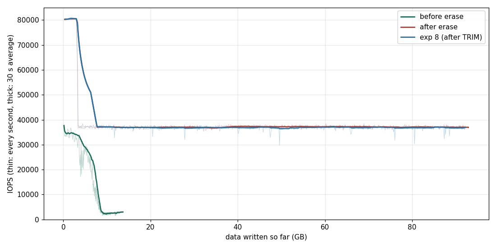
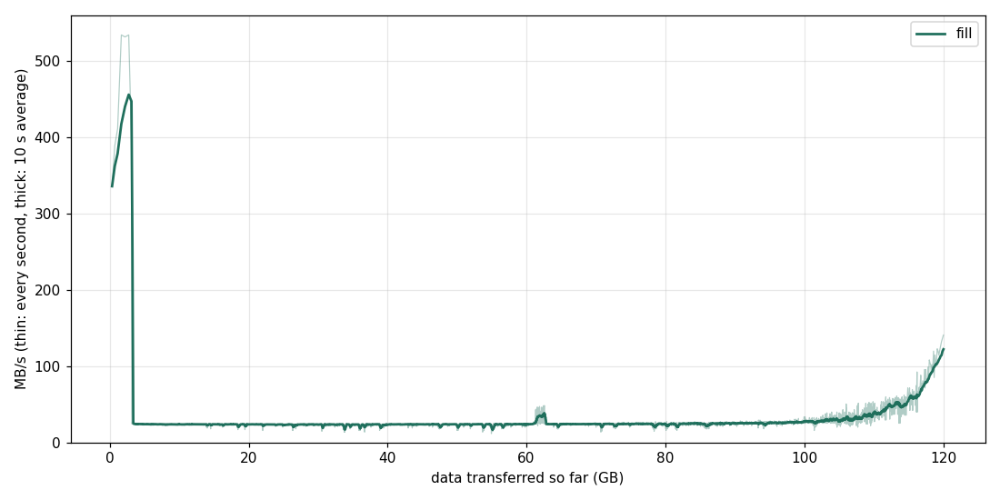

<style>
.glance { display:grid; grid-template-columns: 9rem 1fr; gap:4px 14px; background:#f4f8f6; border:1px solid #cfe3db; border-left:4px solid #1f6f5c; padding:12px 16px; margin:1.2rem 0; font-size:0.93rem; }
.glance b { color:#1f6f5c; }
.warn { background:#fdf2f0; border-left:4px solid #c0392b; padding:10px 14px; margin:1.2rem 0; font-size:0.93rem; }
.tip { background:#eef8f1; border-left:4px solid #1e8449; padding:10px 14px; margin:1.2rem 0; font-size:0.93rem; }
.check { background:#f7f9fb; border-left:4px solid #5d6d7e; padding:10px 14px; margin:1.2rem 0; font-size:0.93rem; }
.result { background:#fffbea; border:1px dashed #b7950b; padding:12px 16px; margin:1.2rem 0; font-size:0.93rem; }
.step-nav { display:flex; justify-content:space-between; gap:1rem; margin:2.5rem 0 0; font-size:0.95rem; }
table.t { table-layout:fixed !important; width:100% !important; border-collapse:collapse; font-size:0.86rem; margin:1rem 0; }
table.t th { background:#e8f3ef !important; color:#1f3d34 !important; text-align:left; padding:6px 8px; border:1px solid #cfe3db; overflow-wrap:break-word; word-break:break-word; }
table.t td { padding:6px 8px; border:1px solid #e5e8e8; vertical-align:top; overflow-wrap:break-word; word-break:break-word; }
table.t code { font-size:0.82rem; }
@media (max-width: 640px) { .glance { grid-template-columns: 1fr; } }
</style>

# 14. ATA Secure Erase : 드라이브가 스스로 지우는 데 걸리는 시간

<div class="glance">
<b>목표</b><span>꽉 차고 GC 로 지친 드라이브에 ATA SECURITY ERASE UNIT 을 보내, 걸린 시간 · 지운 뒤의 내용 (모두 0?) · 쓰기 속도가 처음 상태로 돌아오는지를 재고, <code>blkdiscard</code> (TRIM) 와 비교한다</span>
<b>보는 FTL 개념</b><span>블록 지우기 (erase), 매핑 표 초기화, 자체 암호화 드라이브의 암호 키 교체 (crypto erase), FOB 상태 되돌리기</span>
<b>지우나?</b><span>예 (그것이 실험이다)</span>
<b>연결</b><span>SATA (USB 어댑터는 보안 명령을 막는 일이 많다)</span>
<b>시간</b><span>실제 97분 : 채우기 76분 (TRIM 없이 덮어써서 예상 15분보다 길었다) + 사전 쓰기 10분 + 지우기 3초 + 확인 11분</span>
<b>명령</b><span><code>sudo ./lab.sh secerase</code>, <code>sudo ./lab.sh secerase enhanced</code></span>
</div>

## 배경

`blkdiscard` (TRIM) 는 '이 LBA 들은 이제 안 쓴다' 는 알림일 뿐이다. 드라이브는 매핑을 지우고 블록은 나중에 (GC 가) 지운다.
**Secure Erase** 는 ATA 표준 명령으로, 드라이브에게 '사용자 영역 전부를 지금 지워라' 고 시킨다. 컨트롤러가 무엇을 하는지는 드라이브마다 다르다 :

<div style="overflow-x:auto;"><table class="t">
<thead><tr>
<th>방법</th>
<th>하는 일</th>
<th>걸리는 시간</th>
</tr></thead><tbody>
<tr><td>모든 블록 지우기</td><td>NAND 블록을 하나씩 erase</td><td>블록 수 × 지우기 시간 ÷ 병렬성 : 수십 초–몇 분</td></tr>
<tr><td>암호 키 교체 (crypto erase)</td><td>항상 암호화하는 드라이브 (SED) 는 키만 새로 만든다 : 옛 데이터는 읽어도 의미 없는 값</td><td>거의 즉시. 보통 매핑 초기화 · 블록 지우기도 같이 한다</td></tr>
<tr><td>Enhanced</td><td>표준상 '제조사가 정한 무늬로 덮어쓰기' 도 포함 (예비 영역 등)</td><td>드라이브가 말하는 시간</td></tr>
</tbody></table></div>

이 드라이브는 항상 암호화한다 (실험 0 의 `hdparm -I` : `Device encrypts all user data`). 그렇다면 Secure Erase 는 키 교체를 포함할 것이다.

## 꼭 알아야 할 것 : frozen, 비밀번호

<div class="warn" markdown="1">
- **frozen** : 많은 BIOS 가 부팅할 때 보안 명령을 잠근다 (`hdparm -I` 의 Security 아래 `frozen`). 그러면 `lab.sh` 가 멈춘다. 푸는 법 : `sudo systemctl suspend` 로 절전했다가 깨운다 (드라이브가 전원을 다시 받으며 잠금이 풀린다). 그래도 frozen 이면 드라이브의 SATA 전원을 잠깐 뽑았다 꽂는 방법이 있지만, 실험 17 처럼 USB 어댑터에서 하는 편이 안전하다 (그런데 어댑터가 보안 명령을 막을 수 있다).
- **비밀번호** : Secure Erase 를 하려면 먼저 사용자 비밀번호를 정해야 한다 (표준이 그렇다). `lab.sh` 는 임시 비밀번호 `lab` 을 쓰고, 지우기가 성공하면 비밀번호도 사라진다.
- **중간에 끊기면** (전원, Ctrl+C) 비밀번호가 남아 드라이브가 **잠긴다**. 풀기 :

```
$ D=/dev/disk/by-id/ata-Samsung_SSD_840_EVO_120GB_S1D6NSAFB40389K
$ sudo hdparm --user-master u --security-unlock lab $D
$ sudo hdparm --user-master u --security-disable lab $D
```
</div>

## 가설과 예상

<div style="overflow-x:auto;"><table class="t">
<thead><tr>
<th>가설</th>
<th>맞다면 보일 것</th>
</tr></thead><tbody>
<tr><td>H1 지우기는 빠르다</td><td><code>erase_seconds</code> 가 <code>hdparm -I</code> 의 예상 시간 (예 : <code>2min for SECURITY ERASE UNIT</code>) 이하. 몇 초라면 키 교체 + 매핑 초기화</td></tr>
<tr><td>H2 지운 뒤에는 모두 0 으로 읽힌다</td><td><code>scan.csv</code> 의 <code>zero_frac</code> 이 모든 구간에서 1 (매핑이 없으니 NAND 를 안 읽고 0)</td></tr>
<tr><td>H3 FOB 로 돌아온다</td><td><code>after-4k</code> 의 처음 몇 분 IOPS 가 <code>before-4k</code> (지친 상태) 보다 훨씬 높고, 실험 8 의 시작 부분과 같다</td></tr>
<tr><td>H4 블록을 실제로 지웠다면 마모가 는다</td><td>SMART 177 이 +1 쯤 (모든 블록 한 번 지움). 그대로면 지우기를 미루거나 하지 않았다</td></tr>
<tr><td>H5 enhanced 는 다르다</td><td><code>secerase enhanced</code> 의 시간이 확실히 다르면, 두 명령의 구현이 다르다</td></tr>
</tbody></table></div>

## 절차

```
$ sudo ./lab.sh features              # Security 부분을 먼저 본다 (실험 2 에서 이미 했다면 생략)
$ sudo ./lab.sh secerase              # normal
$ sudo ./lab.sh secerase enhanced     # 선택 : 다시 채우고 지친 상태에서 enhanced
```

<div style="overflow-x:auto;"><table class="t">
<thead><tr>
<th>단계</th>
<th>하는 일</th>
</tr></thead><tbody>
<tr><td>0</td><td>Security 상태 확인 : supported, not enabled, not frozen 이 아니면 멈춘다</td></tr>
<tr><td>1</td><td>1 MiB 순차로 전체를 채우고, 4 KiB 랜덤 쓰기 10분 (<code>before-4k</code>) : 꽉 차고 지친 상태</td></tr>
<tr><td>2</td><td>SMART 기록, 임시 비밀번호 설정</td></tr>
<tr><td>3</td><td><code>hdparm --security-erase</code> (또는 <code>-enhanced</code>) : 드라이브가 끝낼 때까지 기다리며 시간을 잰다</td></tr>
<tr><td>4</td><td>Security 상태 (비밀번호가 사라졌나), SMART 기록</td></tr>
<tr><td>5</td><td>스캔 (256 MiB 마다 8 MiB) : 모두 0 인가</td></tr>
<tr><td>6</td><td>4 KiB 랜덤 쓰기 10분 (<code>after-4k</code>) : 빈 블록이 돌아왔나</td></tr>
</tbody></table></div>

## 결과 읽는 법

```
$ D=$(ls -d ~/Ryu/old_ssd_results/*-secerase-normal | tail -1)
$ grep erase_seconds $D/meta.txt
$ python3 plot.py se.png $D/before-4k_iops.log=before $D/after-4k_iops.log=after
$ python3 smartdiff.py $D
```

비교 기준 : 실험 8 은 매번 `blkdiscard` 로 시작한다. 실험 8 의 처음 몇 분과 `after-4k` 가 같은 높이라면, 이 드라이브에서 TRIM 전체와 Secure Erase 는 성능상 같은 결과를 낸다 (차이는 '데이터를 정말 지웠나' 쪽에 있다).

## 결과

<div class="result" markdown="1">
2026.11.01 09:34 – 11:11 (97분), 결과 폴더 `20261101-093452-secerase-normal`. `normal` 만 실행했다 (`enhanced` 는 아직). 실험 13 바로 뒤라 드라이브는 TRIM 없이 그 상태 그대로 시작했다.

<div style="overflow-x:auto;"><table class="t">
<thead><tr>
<th>단계</th>
<th>시각</th>
<th>걸린 시간</th>
<th>결과</th>
</tr></thead><tbody>
<tr><td>채우기 (1 MiB 순차)</td><td>09:34 – 10:51</td><td><strong>76분</strong></td><td>평균 약 26 MB/s (예상은 13분 : 아래 '뜻밖의 결과')</td></tr>
<tr><td><code>before-4k</code> (지친 상태)</td><td>10:51 – 11:01</td><td>10분</td><td>평균 5,564 IOPS, 끝 무렵 약 2,900 IOPS</td></tr>
<tr><td>SECURITY ERASE UNIT</td><td>11:01</td><td><strong>3초</strong></td><td>성공, 비밀번호도 사라짐 (<code>not enabled</code>)</td></tr>
<tr><td>스캔</td><td>11:01</td><td>1분 안</td><td>448곳 모두 0</td></tr>
<tr><td><code>after-4k</code></td><td>11:01 – 11:11</td><td>10분</td><td>평균 37,765 IOPS</td></tr>
</tbody></table></div>



**H1 (지우기는 빠르다) : 맞다.** `erase_seconds` 는 3 (초 단위 시계라 2 – 4초). `hdparm -I` 가 말한 2분의 약 40분의 1이다. 드라이브가 말한 시간은 실제 시간이 아니라 넉넉한 상한으로 보인다.

**H2 (지운 뒤에는 모두 0) : 맞다.** 256 MiB 마다 8 MiB 씩 읽은 448곳 (3.5 GiB, 전체의 약 3%) 의 `zero_frac` 이 모두 1.000, 속도는 378 – 523 MB/s (평균 441). 표본 검사이므로 '전체가 0' 을 증명하지는 않는다.

**H3 (FOB 로 돌아온다) : 맞다, 성능으로는 TRIM 과 구별되지 않는다.** 그림에서 `after` 는 실험 8 과 겹친다 : 처음 약 3.2 GB 는 약 8만 IOPS (SLC 버퍼), 그 뒤 약 37,000 IOPS 로 평평.

<div style="overflow-x:auto;"><table class="t">
<thead><tr>
<th></th>
<th>처음 1분 평균 IOPS</th>
<th>처음 10분 평균 IOPS</th>
<th>쓰기 99%</th>
<th>쓰기 99.9%</th>
</tr></thead><tbody>
<tr><td><code>before-4k</code> (지친 상태)</td><td>27,948</td><td>5,564</td><td>64.8 ms</td><td>94.9 ms</td></tr>
<tr><td><code>after-4k</code> (Secure Erase 뒤)</td><td>44,187</td><td>37,765</td><td>4.4 ms</td><td>13.2 ms</td></tr>
<tr><td>실험 8, 10.18 (TRIM 뒤)</td><td>43,862</td><td>36,940</td><td>–</td><td>–</td></tr>
<tr><td>실험 8, 10.23 (TRIM 뒤)</td><td>44,201</td><td>37,557</td><td>–</td><td>–</td></tr>
</tbody></table></div>

평균으로는 6.8배지만 `before` 의 평균은 처음 1분이 끌어올린 값이다. 마지막 1분끼리 비교하면 2,974 대 37,003, **약 12배**. 37,000 IOPS × 4 KiB ≈ 152 MB/s 는 실험 3 의 TLC 쓰기 속도 (약 150 MB/s) 와 같다 : GC 가 없으면 4 KiB 랜덤 쓰기도 NAND 쓰기 속도까지 나온다.

단, `after-4k` 는 92.8 GB 만 썼다. 실험 8 의 절벽 (약 128 GB) 전에 끝났으므로 **절벽 자리까지 같은지는 재지 못했다.**

**H4 (블록을 실제로 지웠다면 177 이 는다) : 3초 안에는 지우지 않았다.** 지우기 앞뒤로 177 은 203 그대로, 241 도 그대로. 다 지웠다면 평균 지우기 횟수가 +1 이어야 한다. 시간도 맞지 않는다 : 블록 1.5 MiB, die 8개, 블록 지우기 3 ms 로 가정하면 (이 드라이브에서 잰 값이 아니다) 전체를 지우는 데 약 33초다. 3초는 매핑 표 초기화 (+ 암호 키 교체) 쪽에 맞는다. 다만 SMART 를 지운 직후에 읽었으므로, 블록을 나중에 필요할 때 지우는 것까지 부정하지는 않는다.

**H5 (enhanced 는 다르다) : 아직 모른다.** 실행 전.

### 실제로 무슨 일이 일어났나

3초 · 177 변화 없음 · 모두 0 · TRIM 과 같은 성능을 합치면, 드라이브는 **'매핑을 비우고 블록을 빈 것으로 표시' 했다** 고 보는 것이 가장 단순하다. `hdparm -I` 에 `Device encrypts all user data` 가 있으므로 키도 바꿨을 것이다.

하지만 **키 교체는 이 실험으로 확인되지 않는다.** 매핑이 없으면 드라이브는 NAND 를 읽지 않고 0 을 돌려주므로, 키를 바꿨든 안 바꿨든 호스트에게는 똑같이 보인다. '데이터가 정말 사라졌나' 는 NAND 를 직접 읽지 않고는 알 수 없고, 제조사의 구현을 믿어야 하는 부분이다.

### 뜻밖의 결과 : 순차 쓰기가 24 MB/s

이 실험의 목적은 아니었지만, 가장 놀라운 숫자는 채우기였다.



처음 약 3 GB 만 533 MB/s (SLC 버퍼), 그 뒤 약 100 GB 까지 **약 24 MB/s**, 마지막 20 GB 에서야 약 140 MB/s 까지 오른다. 같은 1 MiB 순차 쓰기인데 드라이브의 **이전 상태** 에 따라 약 6배 차이가 난다 :

<div style="overflow-x:auto;"><table class="t">
<thead><tr>
<th>실험</th>
<th>쓰기 전 상태</th>
<th>1 MiB 순차 쓰기</th>
</tr></thead><tbody>
<tr><td>13 의 채우기</td><td>TRIM 한 드라이브</td><td>약 144 MB/s</td></tr>
<tr><td>12 <code>seqwaf</code></td><td>순차로 꽉 찬 드라이브를 덮어쓰기</td><td>약 151 MB/s</td></tr>
<tr><td>13 의 <code>seqwrite</code></td><td>랜덤 쓰기 직후 (읽기와 함께)</td><td>42 MB/s</td></tr>
<tr><td><strong>14 의 채우기</strong></td><td><strong>랜덤 쓰기로 흐트러진 드라이브 (TRIM 없음)</strong></td><td><strong>약 24 MB/s</strong></td></tr>
</tbody></table></div>

24 MB/s 는 실험 8 의 랜덤 4 KiB steady state (24 MB/s) 와 같은 값이다.

가설 : 실험 13 의 랜덤 쓰기는 약 16 GB 뿐이었지만, 그동안 GC 가 드라이브의 상당 부분을 옮겨 쓰면서 **이웃한 LBA 들이 다른 블록으로 흩어졌다.** 그러면 순차로 덮어써도 한 블록이 통째로 무효가 되지 않고, 쓰는 내내 GC 가 유효 페이지를 옮겨야 한다. NAND 쓰기를 실험 12 의 GC 중 약 60 MB/s 로 잡으면 WAF 는 약 2.5 다. 이 값은 추정이다 : 이번 실행은 채우기 앞뒤의 SMART 를 따로 찍지 않아 채우기만의 WAF 는 재지 못했다.

이 가설로 설명되지 않는 것도 있다. 단순하게 생각하면 덮어쓴 양에 따라 속도가 서서히 올라야 하는데, 실제로는 100 GB 까지 평평하다가 끝에서만 오른다.

**실용적인 교훈** : '순차 쓰기는 늘 빠르다' 는 틀렸다. 랜덤 쓰기를 겪은 드라이브는 TRIM 없이는 순차로도 느리다.

### SMART 187 · 195 = 108 에 대해

이번 SMART 에 `187 Uncorrectable_Error_Cnt` 와 `195 ECC_Error_Rate` 가 108 로 나온다. 실험 0 에서는 0 이었으니 고장 신호처럼 보이지만, **NAND 가 망가진 것이 아니다.** 2026.10.23 아침 SSD tester 과정 (C++ Library 의 S4 · S5) 의 시험이 `WRITE UNCORRECTABLE EXT` 로 **일부러** 만든 오류다.

- 저장해 둔 시험 출력에 값이 오르는 과정이 남아 있다 : 1 → 33 → 69 → 105.
- SMART 오류 로그의 마지막 기록도 `WRITE UNCORRECTABLE EXT` (feature 0x55) 와 그 근처 LBA (8311 등) 를 가리킨다.
- 그 뒤 11.01 까지 9일 동안 약 3.9 TB 를 쓰는 사이 108 에서 한 번도 늘지 않았다. 5 · 179 · 181 · 182 · 183 도 모두 0.

그러니 앞으로 이 값이 **108 보다 늘면** 그때가 진짜 오류다. 실험 15 · 16 · 18 은 0 이 아니라 108 을 기준으로 본다.

### 다음

- 선택 : `sudo ./lab.sh secerase enhanced` (H5). 지금 드라이브에는 `after-4k` 의 랜덤 데이터가 있으므로 채우기가 또 오래 걸릴 수 있다 (약 1.5 – 2시간).
- 실험 15 (read disturb).
</div>

<div class="step-nav"><a href="{{ '/old-ssd-experiments/13-interference/' | relative_url }}">← 13. 읽기 · 쓰기 간섭</a><a href="{{ '/old-ssd-experiments/15-read-disturb/' | relative_url }}">15. Read disturb →</a></div>
