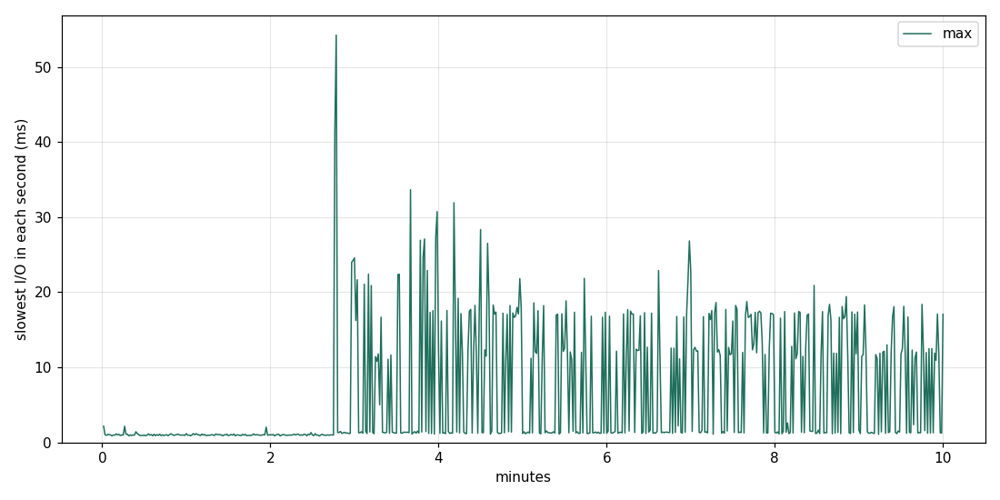
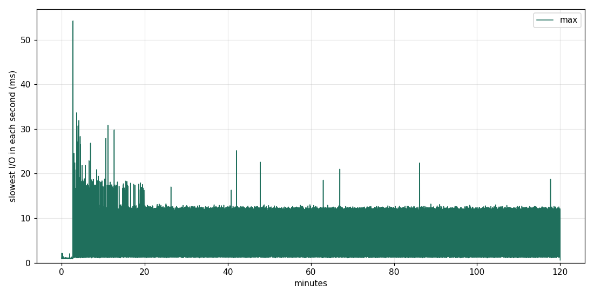
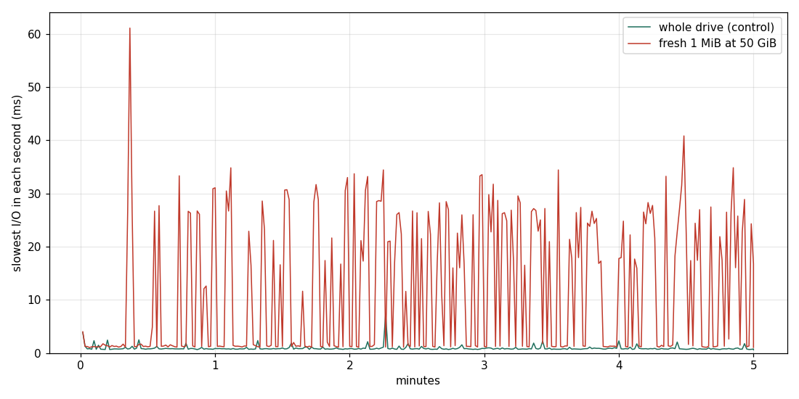
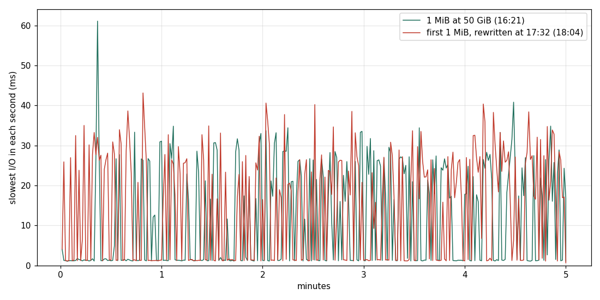

<style>
.glance { display:grid; grid-template-columns: 9rem 1fr; gap:4px 14px; background:#f4f8f6; border:1px solid #cfe3db; border-left:4px solid #1f6f5c; padding:12px 16px; margin:1.2rem 0; font-size:0.93rem; }
.glance b { color:#1f6f5c; }
.warn { background:#fdf2f0; border-left:4px solid #c0392b; padding:10px 14px; margin:1.2rem 0; font-size:0.93rem; }
.tip { background:#eef8f1; border-left:4px solid #1e8449; padding:10px 14px; margin:1.2rem 0; font-size:0.93rem; }
.check { background:#f7f9fb; border-left:4px solid #5d6d7e; padding:10px 14px; margin:1.2rem 0; font-size:0.93rem; }
.result { background:#fffbea; border:1px dashed #b7950b; padding:12px 16px; margin:1.2rem 0; font-size:0.93rem; }
.step-nav { display:flex; justify-content:space-between; gap:1rem; margin:2.5rem 0 0; font-size:0.95rem; }
table.t { table-layout:fixed !important; width:100% !important; border-collapse:collapse; font-size:0.86rem; margin:1rem 0; }
table.t th { background:#e8f3ef !important; color:#1f3d34 !important; text-align:left; padding:6px 8px; border:1px solid #cfe3db; overflow-wrap:break-word; word-break:break-word; }
table.t td { padding:6px 8px; border:1px solid #e5e8e8; vertical-align:top; overflow-wrap:break-word; word-break:break-word; }
table.t code { font-size:0.82rem; }
@media (max-width: 640px) { .glance { grid-template-columns: 1fr; } }
</style>

# 15. Read disturb : 같은 곳을 수억 번 읽으면

<div class="glance">
<b>목표</b><span>드라이브를 검사 가능한 무늬로 채운 뒤, 맨 앞 1 MiB 만 몇 시간 동안 계속 읽는다. 펌웨어가 그 블록을 옮기는 순간 (지연이 튀는 곳) 이 보이는지, 이웃 데이터가 상했는지 확인한다</span>
<b>보는 FTL 개념</b><span>read disturb (읽기 전압이 이웃 셀을 조금씩 프로그램함), 읽기 횟수 세기, read reclaim (블록 옮기기), ECC</span>
<b>지우나?</b><span>예</span>
<b>연결</b><span>SATA</span>
<b>시간</b><span>실제 2시간 38분 : 채우기 33분 + 두드리기 2시간 + 확인 5분 (기본값 6시간은 쓰지 않았다)</span>
<b>명령</b><span><code>sudo ./lab.sh disturb 2</code></span>
</div>

## 배경

NAND 에서 한 페이지를 읽으려면 같은 블록의 **다른 모든 줄 (word line)** 에 높은 '통과 전압' 을 건다. 이 전압이 그 줄들의 셀에 전자를 아주 조금씩 밀어 넣는다. 한두 번은 아무 일도 없지만, 같은 블록을 수만–수십만 번 읽으면 이웃 셀의 전압이 올라가 비트 오류가 생긴다 : **read disturb**.
그래서 FTL 은 블록마다 읽은 횟수를 세고, 한도를 넘으면 그 블록의 데이터를 새 블록으로 옮긴다 (read reclaim). 그 순간 그 블록을 읽는 요청은 기다린다.

<div style="overflow-x:auto;"><table class="t">
<thead><tr>
<th>이 실험에서</th>
<th>크기</th>
</tr></thead><tbody>
<tr><td>두드리는 영역</td><td>맨 앞 1 MiB (4 KiB × 256개). TLC 블록 하나 (수 MiB 로 짐작) 안이거나 두세 개에 걸친다</td></tr>
<tr><td>읽기 속도</td><td>QD32 4 KiB 랜덤 읽기 : 수만 IOPS</td></tr>
<tr><td>6시간 동안</td><td>수억 번 읽기 → 블록 하나가 수억 번 읽힌다 (흔히 말하는 한도 : 수만–수십만 번)</td></tr>
</tbody></table></div>

## 가설과 예상

<div style="overflow-x:auto;"><table class="t">
<thead><tr>
<th>가설</th>
<th>맞다면 보일 것</th>
</tr></thead><tbody>
<tr><td>H1 펌웨어가 읽기 횟수를 세어 블록을 옮긴다</td><td><code>hammer_lat.log</code> (1초마다 가장 느린 읽기) 에 주기적인 큰 튐 : 옮기는 동안의 대기. 튀는 간격 = 읽기 한도 ÷ IOPS</td></tr>
<tr><td>H2 옮기기 덕분에 데이터는 상하지 않는다</td><td>verify 의 나쁜 블록 = 0</td></tr>
<tr><td>H3 옮기기 전까지는 이웃이 조금씩 나빠진다</td><td><code>near-after</code> 의 지연 (앞 1 GiB) 이 <code>near-before</code> 보다 길거나, SMART 195 (ECC 로 고친 오류) 가 는다</td></tr>
<tr><td>H4 컨트롤러가 읽기를 RAM 에 담아 둔다면</td><td>IOPS 가 SATA 한계 (약 10만) 근처이고 지연이 아주 짧고 고르다 : NAND 를 안 읽는다 (그러면 이 실험은 다른 방법이 필요하다)</td></tr>
</tbody></table></div>

## 절차

```
$ sudo ./lab.sh disturb 2        # 숫자 = 두드릴 시간 (시간 단위)
```

<div style="overflow-x:auto;"><table class="t">
<thead><tr>
<th>단계</th>
<th>하는 일</th>
</tr></thead><tbody>
<tr><td>1</td><td>전체를 1 MiB 순차로 쓰되 4 KiB 마다 crc32c 머리말 (실험 16 과 같은 무늬)</td></tr>
<tr><td>2</td><td><code>near-before</code> : 앞 1 GiB 안의 4 KiB 랜덤 읽기 QD1, 60초</td></tr>
<tr><td>3</td><td>SMART 기록</td></tr>
<tr><td>4</td><td><code>hammer</code> : 앞 1 MiB 만 4 KiB 랜덤 읽기 QD32, HOURS 시간. 1초마다 IOPS 와 가장 느린 읽기 기록</td></tr>
<tr><td>5</td><td>SMART 기록, <code>near-after</code> (2 와 같은 측정)</td></tr>
<tr><td>6</td><td>전체 verify : 모든 4 KiB 블록의 체크섬 → <code>verify-summary.txt</code></td></tr>
</tbody></table></div>

## 결과 읽는 법

```
$ D=$(ls -d ~/Ryu/old_ssd_results/*-disturb-* | tail -1)
$ python3 plot.py hammer-lat.png $D/hammer_lat.log=max
$ python3 plot.py hammer-iops.png $D/hammer_iops.log
$ cat $D/verify-summary.txt; python3 smartdiff.py $D
$ column -s, -t $D/summary.csv
```

1. **튐의 간격** : 두 튐 사이의 시간 × 평균 IOPS ÷ (1 MiB 가 걸친 블록 수) ≈ 펌웨어의 읽기 한도. Claude 가 로그에서 튐을 찾아 계산한다.
2. **verify** : 0 이 아니면 read disturb 로 상한 데이터를 ECC 도 펌웨어도 막지 못한 것이다.
3. **near-before / after** 의 50% · 99% 지연.

## 결과

<div class="result" markdown="1">
2026.11.07 12:32 – 15:10 (2시간 38분), 결과 폴더 `20261107-123221-disturb-2h`. `sudo ./lab.sh disturb 2` : 6시간 대신 2시간 두드렸다.

<div style="overflow-x:auto;"><table class="t">
<thead><tr>
<th>단계</th>
<th>시각</th>
<th>결과</th>
</tr></thead><tbody>
<tr><td>쓰기 (crc32c 무늬)</td><td>12:32 – 13:05</td><td>33분, 평균 약 61 MB/s</td></tr>
<tr><td><code>near-before</code></td><td>13:05</td><td>8,766 IOPS, 50% 105 µs</td></tr>
<tr><td><code>hammer</code></td><td>13:06 – 15:06</td><td><strong>5.66억 번</strong> 읽기 (2.3 TB), 평균 78,652 IOPS. 4 KiB 하나당 약 221만 번</td></tr>
<tr><td><code>near-after</code></td><td>15:06</td><td>8,324 IOPS, 50% 107 µs</td></tr>
<tr><td>verify</td><td>15:07 – 15:10</td><td>약 525 MiB/s 로 전체 읽기, <strong>나쁜 블록 0</strong></td></tr>
</tbody></table></div>

### 2분 46초에 드라이브가 바뀌었다

예상은 '주기적인 큰 튐' 이었다. 실제 모습은 달랐다. 처음 165초는 완전히 고르다가, **1,465만 번째 읽기쯤에서 상태가 한 번 바뀌고 돌아오지 않았다.**



<div style="overflow-x:auto;"><table class="t">
<thead><tr>
<th>구간</th>
<th>IOPS</th>
<th>1초마다 가장 느린 읽기</th>
</tr></thead><tbody>
<tr><td>0 – 165초</td><td>약 88,800</td><td>약 1.0 ms 로 평평</td></tr>
<tr><td>166 – 167초</td><td><strong>42,113 → 13,945</strong></td><td><strong>41 – 54 ms</strong></td></tr>
<tr><td>168초 – 약 20분</td><td>약 79,000</td><td>약 1.3 ms 또는 12 – 30 ms</td></tr>
<tr><td>약 20분 – 끝</td><td>약 78,400</td><td>1 – 2 ms 또는 <strong>약 11 – 12 ms</strong></td></tr>
</tbody></table></div>



두 가지가 **따로** 일어났다 :

1. **늘 느려졌다.** 멈춤이 없는 초에도 IOPS 는 약 79,400 으로, 처음보다 약 11% 낮다. 멈춤이 있는 초 (약 77,900) 와 2% 차이밖에 없으니, 줄어든 11% 의 대부분은 멈춤 탓이 아니다.
2. **짧게 멈추기 시작했다.** 300초 뒤 6,901초 가운데 '가장 느린 읽기' 가 1 – 2 ms 인 초가 2,487개, 10 ms 이상인 초가 4,379개 (63%), 그 사이 (2 – 10 ms) 는 34개뿐이다. 중간이 없다 : 멈춤 하나의 길이가 약 11 ms 로 정해져 있다는 뜻이다.

멈춤의 시각에는 **주기가 없다.** 1 – 40초 간격의 자기상관이 모두 0 근처, FFT 에도 두드러진 주기가 없다. 63% 라는 비율은 평균 1초에 한 번쯤 무작위로 일어나는 사건과 맞는다.

**온도는 원인이 아니다.** 드라이브는 이때 약 39 → 45 °C 로 올랐지만, 두드리기가 끝난 직후 44 °C 에서 돈 `near-after` (QD1) 의 max 는 2.1 ms 로 멈춤이 없었고, verify 도 SATA 한계 속도였다. 실험 14 의 쓰기 뒤에는 46 °C 였다. SCT 의 Over Temperature 횟수는 +28 이 늘었지만, 다른 실험에서도 시간당 비슷하게 는다.

### 가설별 판정

**H1 (펌웨어가 읽기 횟수를 세어 블록을 옮긴다) : 무언가를 세는 것은 맞아 보이지만, 옮기기라는 증거는 없다 (아래 후속 시험에서 더 좁혔다).** 165초 동안 고르다가 갑자기 바뀌었으니 시간보다 횟수 쪽이 그럴듯하고, 첫 41 – 54 ms 는 read reclaim 의 한 번 옮기기처럼 보인다. 그런데 나머지는 예상과 어긋난다 :

- 한도가 1,465만 번이라면 다음 사건은 약 3분 뒤여야 한다. 실제로는 약 1초마다 멈춘다.
- 177 은 205 그대로. 다만 177 이 +1 되려면 약 137 GB 를 써야 하므로, 블록 몇 개를 옮긴 정도로는 어차피 움직이지 않는다. 옮겼다는 증거도, 안 옮겼다는 증거도 아니다.
- 한도는 계산할 수 없다. 1 MiB 가 몇 개의 블록에 걸치는지 모르기 때문이다 (블록 1개면 1,465만 번, 8개면 약 180만 번).

**H2 (데이터는 상하지 않는다) : 맞다.** 전체 약 2,930만 개의 4 KiB 블록 가운데 나쁜 블록 0. 그리고 이 '0' 은 믿을 수 있다 : 같은 fio 옵션으로 파일에서 시험해 보니, 깨끗할 때 0, 일부러 망가뜨린 블록 2개는 정확히 2개로 잡혔다. SMART 187 · 195 도 기준선 108 그대로 ([실험 14](/old-ssd-experiments/14-secure-erase/)). 단, 2시간만 두드린 결과다.

**H3 (이웃이 조금씩 나빠진다) : 이 측정으로는 알 수 없다.** 수치로는 약간 나빠졌다 (IOPS −5%, 99% 144 → 155 µs, 99.9% 191 → 206 µs). 그러나 이것을 read disturb 의 증거로 볼 수는 없다 :

- 1초마다의 IOPS 흔들림 (`near-before` 표준편차 850, 평균의 약 10%) 이 5% 차이보다 크고, 측정은 한 번씩뿐이다.
- `near` 는 앞 1 GiB 전체를 읽으므로, 두드린 1 MiB 에 닿는 읽기는 1,024번에 1번뿐이다. 이웃을 보기에는 너무 넓다.
- **195 는 쓸모가 없었다.** 이 드라이브의 195 는 지금까지 늘 187 과 같은 값이다 (0 → 108). 'ECC 로 고친 오류' 를 세지 않는 것으로 보이므로, 페이지의 예상은 틀린 지표를 골랐다.

**H4 (컨트롤러가 RAM 에 담아 둔다) : 이 측정으로는 판정 못 함 (후속 시험의 답 : 아니다).** 처음의 88,800 IOPS 는 드라이브 전체 랜덤 읽기 (실험 5 : 90,693) 와 거의 같다. 하지만 QD32 에서는 어느 쪽이든 SATA 쪽이 먼저 막히므로, 이 값으로는 NAND 를 읽었는지 알 수 없다. 이 답이 중요한 이유 : 캐시가 읽기를 받아 냈다면 NAND 가 실제로 읽힌 횟수는 5.66억 번보다 훨씬 적다.

**이 결과의 한계.** 이 시험에는 대조군이 없었다 (아래 후속 시험에서 돌렸다). 실험 5 의 QD32 랜덤 읽기 (max 0.84 ms) 는 20초만 돌았으므로 166초 뒤의 일을 말해 주지 못한다. '같은 곳을 읽어서' 인지 '오래 읽어서' 인지를 가르려면 드라이브 전체를 3분 넘게 읽어 봐야 한다.

### 덤 : 쓰기 속도

이번 채우기는 33분으로 실험 14 (76분) 보다 빨랐다. 처음 약 28 GiB 는 약 145 – 170 MiB/s, 중간은 36 – 56 MiB/s 로 내려갔다가 끝에서 76 MiB/s 까지 오른다. 그 전 쓰기는 지운 드라이브에 랜덤 92.8 GB 였는데, 실험 11 의 모델로는 LBA 의 약 46% 가 아직 한 번도 쓰이지 않았다 : 여유가 많아 실험 14 보다 덜 느렸을 것이다 (모델로 맞춘 것이고, 확인한 것은 아니다).

### 후속 시험 : `hammer-check` (2026.11.07 16:21 – 16:34)

결과 폴더 `20261107-162100-hammer-check`. 읽기만 했다 (쓰기 0, 241 그대로, 전원을 끄지 않아 앞의 실험과 이어진 상태). 위의 물음 가운데 둘은 답이 나왔고, 내 예측 하나는 틀렸다.



<div style="overflow-x:auto;"><table class="t">
<thead><tr>
<th>시험</th>
<th>읽기 수</th>
<th>IOPS</th>
<th>50%</th>
<th>1초마다 최대가 5 ms 넘은 초</th>
</tr></thead><tbody>
<tr><td>앞 1 MiB, QD1, 1분</td><td>43만</td><td>7,130</td><td>125 µs</td><td>60초 중 9초</td></tr>
<tr><td>드라이브 전체, QD32, 5분</td><td>2,699만</td><td>89,960</td><td>338 µs</td><td>300초 중 1초 (7.4 ms)</td></tr>
<tr><td>50 GiB 의 새 1 MiB, QD32, 5분</td><td>2,364만</td><td>78,797</td><td>338 µs</td><td>301초 중 136초</td></tr>
</tbody></table></div>

**대조군 : '같은 곳을 읽어서' 가 맞다.** 드라이브 전체를 2,699만 번 읽는 동안 (1,465만 번을 훌쩍 넘긴다) 약 90,000 IOPS 로 평평했고 멈춤도 없었다. 그러니 시간이나 드라이브 전체의 읽기 횟수가 아니라, **같은 곳을 되풀이해 읽은 것** 이 원인이다.

**H4 (RAM 캐시) : 아니다.** 앞 1 MiB 의 QD1 은 50% 125 µs 로, 실험 4 의 '매핑 있는 읽기' (121 µs) 와 같고 'NAND 를 안 읽는 값' (63 µs) 의 두 배다. 읽기는 NAND 까지 간다. 따라서 5.66억 번도 실제 NAND 읽기로 보는 것이 맞다 (QD1 으로 잰 값이므로 QD32 에서의 동작은 추정).

**H1 의 내 예측은 틀렸다 : 횟수가 같지 않았다.** 새 1 MiB 는 1,465만 번이 아니라 **약 173만 번째 읽기 (21 – 22초)** 에서 바뀌었다. 약 8.5배 일찍이다. 하지만 사건의 모습은 같다 :

<div style="overflow-x:auto;"><table class="t">
<thead><tr>
<th></th>
<th>사건 전 IOPS</th>
<th>사건이 일어난 읽기 수</th>
<th>사건 순간</th>
<th>사건 뒤 IOPS</th>
</tr></thead><tbody>
<tr><td>앞 1 MiB (실험 15)</td><td>약 88,800</td><td>약 1,465만</td><td>13,945 IOPS, 54 ms</td><td>약 81,500</td></tr>
<tr><td>50 GiB 의 1 MiB</td><td>약 82,900</td><td>약 173만</td><td>7,550 IOPS, 61 ms</td><td>약 81,800</td></tr>
</tbody></table></div>

**멈춤은 시간이 아니라 읽기 횟수를 따른다.** 멈춤이 있는 초의 비율로 '멈춤 하나당 읽기 수' 를 어림하면 (무작위로 일어난다고 가정) :

<div style="overflow-x:auto;"><table class="t">
<thead><tr>
<th>경우</th>
<th>IOPS</th>
<th>멈춤의 빈도</th>
<th>멈춤 하나당 읽기</th>
</tr></thead><tbody>
<tr><td>실험 15, 20분 뒤</td><td>약 78,400</td><td>초당 약 1.0번</td><td>약 7.6만</td></tr>
<tr><td>새 1 MiB, 사건 뒤</td><td>약 78,800</td><td>초당 약 0.65번</td><td>약 12만</td></tr>
<tr><td>앞 1 MiB, QD1</td><td>7,130</td><td>초당 약 0.16번 (9초뿐이라 거친 값)</td><td>약 4.4만</td></tr>
</tbody></table></div>

IOPS 가 11배 다른데도 값은 **모두 약 10만 번 안팎** 이다. 흔히 말하는 read disturb 한도 (수만 – 수십만 번) 와 같은 크기다.

**한 번 바뀐 상태는 남는다.** 앞 1 MiB 는 두드리기가 끝나고 75분 뒤에도, QD1 의 가벼운 읽기에서 멈췄다 (18 – 24 ms). 이때 드라이브는 29 °C 였으니 온도 설명은 더더욱 맞지 않는다.

### 지금까지의 그림 (가설)

측정한 것과 추측을 나누면 :

<div style="overflow-x:auto;"><table class="t">
<thead><tr>
<th>구분</th>
<th>내용</th>
</tr></thead><tbody>
<tr><td>측정</td><td>같은 곳을 읽으면 어느 순간 큰 멈춤이 한 번 오고, 그 뒤로는 약 10만 번마다 짧게 멈춘다. 드라이브 전체를 읽으면 일어나지 않는다. 데이터는 상하지 않았다</td></tr>
<tr><td>측정</td><td>그 순간까지의 횟수는 곳에 따라 다르다 (1,465만, 173만 : 표본 2개)</td></tr>
<tr><td>측정</td><td>QD1 50% : 앞 1 GiB 105 – 107 µs, 두드린 앞 1 MiB 125 µs, 드라이브 전체 122 µs (실험 5)</td></tr>
<tr><td>추측</td><td>첫 사건 = 그 블록을 처음 옮긴 것, 그 뒤의 멈춤 = 약 10만 번마다의 점검이나 옮기기</td></tr>
<tr><td>추측 (후속 시험 2 에서 맞지 않음)</td><td>앞쪽 데이터만 빠른 곳 (SLC 영역?) 에 있어서 잘 버티다가, 옮겨지며 보통 TLC 가 되었다</td></tr>
</tbody></table></div>

(아래 후속 시험 2 에서 이 추측은 맞지 않았다.) 마지막 추측은 세 숫자를 한 번에 설명한다 : 앞 1 MiB 의 늦은 사건 (약 8.5배), 사건 뒤 IOPS 가 새 1 MiB 와 같아진 것 (약 81,500), QD1 이 앞 1 GiB 의 빠른 값에서 드라이브 전체의 값으로 옮겨 간 것. 다만 표본이 적고, 앞쪽 데이터가 정말 SLC 에 있는지는 확인하지 않았으며, 실험 5 의 값은 다른 날의 드라이브 상태다. 옮기기 자체도 177 로는 볼 수 없다 (+1 에 약 137 GB 가 필요하다).

**H3 은 여전히 모른다.** 이웃의 열화를 보려면 두드린 곳 바로 옆만 읽는 측정이 필요한데, 이번 후속 시험에는 넣지 않았다.

### 후속 시험 2 : 다시 쓴 앞 1 MiB 를 다시 두드리기 (2026.11.07 18:04 – 18:17)

결과 폴더 `20261107-180446-hammer-check`, 명령 `sudo ./lab.sh hammer-check 0` : 이번에는 '새 1 MiB' 자리가 앞 1 MiB 다. 그 사이 [실험 16](/old-ssd-experiments/16-retention/) 의 `ret-write` (17:32) 가 드라이브 전체를 새로 썼으므로, 앞 1 MiB 의 데이터는 30분 전에 쓴 새 데이터다. 읽기만 했다 (241 그대로).

위의 'SLC 추측' 이 맞다면 실험 15 의 처음처럼 보여야 했다 : QD1 약 105 µs, 약 88,800 IOPS 로 평평하다가 약 1,465만 번째 읽기에서 사건 한 번.



<div style="overflow-x:auto;"><table class="t">
<thead><tr>
<th>측정</th>
<th>예상 (SLC 추측)</th>
<th>실제</th>
</tr></thead><tbody>
<tr><td>앞 1 MiB, QD1 50%</td><td>약 105 µs</td><td><strong>120 µs</strong> (60초 중 멈춤 1초)</td></tr>
<tr><td>두드리기 IOPS</td><td>약 88,800</td><td><strong>약 77,400</strong> (처음 10초도 79,300)</td></tr>
<tr><td>첫 멈춤</td><td>약 1,465만 번째 읽기에서 사건 한 번</td><td><strong>2초째 (약 8만 번째)</strong> 부터 줄곧, 큰 사건 없음</td></tr>
<tr><td>멈춤 하나당 읽기</td><td>–</td><td>약 10만 번 (301초 중 163초)</td></tr>
<tr><td>드라이브 전체 (대조군)</td><td>평평</td><td>약 90,000 IOPS 로 평평 (6.7 ms 2초뿐)</td></tr>
</tbody></table></div>

**SLC 추측은 맞지 않았다.** 그리고 더 이상한 것이 보인다 : 앞 1 MiB 는 **새로 썼는데도 처음부터 '사건 뒤' 상태** 였다. 그림에서 16:21 의 1 MiB (초록) 는 약 20초 동안 조용하다가 시작하지만, 다시 쓴 앞 1 MiB (빨강) 는 2초째부터 멈춘다.

데이터를 새로 쓰면 NAND 의 다른 페이지 (대개 다른 블록) 로 간다. 그런데도 상태가 남았다면, 드라이브가 기억하는 것은 **물리 블록이 아니라 LBA 범위** 쪽으로 보인다 :

<div style="overflow-x:auto;"><table class="t">
<thead><tr>
<th>구분</th>
<th>내용</th>
</tr></thead><tbody>
<tr><td>측정</td><td>같은 LBA 범위는 데이터를 새로 써도 처음부터 느리고 멈춘다</td></tr>
<tr><td>측정</td><td>처음 두드리는 범위 (50 GiB) 는 사건 전까지 조용하다</td></tr>
<tr><td>추측</td><td>펌웨어가 '많이 읽히는 LBA 범위' 를 따로 기억하고 그 범위를 다르게 다룬다 (예 : 그 범위의 매핑 정보나 데이터를 자주 점검)</td></tr>
<tr><td>추측</td><td>실험 15 의 1,465만 대 173만의 차이도 위치가 아니라 이 기억의 유무나 다른 상태 때문일 수 있다</td></tr>
</tbody></table></div>

이 결과도 표본 하나다. 또 이번 QD1 은 두드리기 바로 앞에 앞 1 MiB 를 43만 번 읽었으므로 그것이 상태를 켰을 가능성도 있다 (다만 50 GiB 의 경우 173만 번 전까지는 조용했다). 이 기억이 얼마나 오래 가는지 (전원을 끄면 사라지는지) 는 아직 모른다.
</div>

<div class="step-nav"><a href="{{ '/old-ssd-experiments/14-secure-erase/' | relative_url }}">← 14. Secure Erase</a><a href="{{ '/old-ssd-experiments/16-retention/' | relative_url }}">16. Retention →</a></div>
