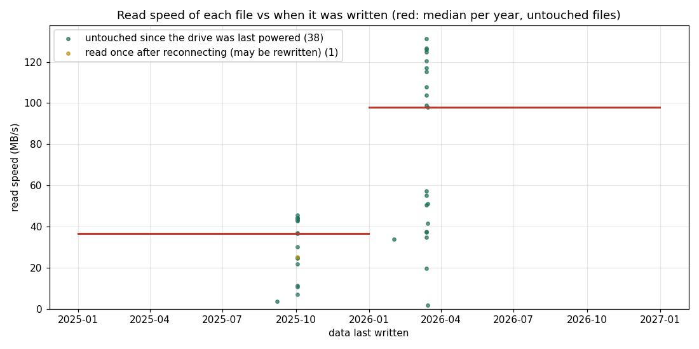
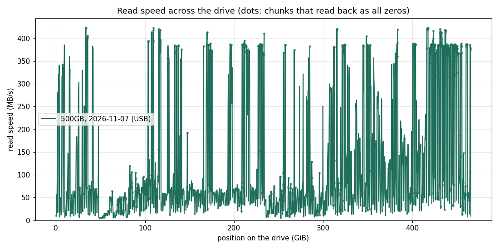

# 20. 두 번째 드라이브 : 500GB SSD 를 읽기만 해서 보기

<b>목표</b>같은 계열의 두 번째 SSD (500GB) 에서 오래된 데이터의 읽기 속도를 재고, 120GB SSD (실험 1) 와 비교한다
<b>보는 FTL 개념</b>데이터의 나이와 읽기 속도 (전하 누설 → 다시 읽기), 펌웨어의 차이
<b>지우나?</b>아니오. 읽기만 한다 (<code>lab.sh --500gb</code> 는 check · smart · scan · oldfiles · reread 만 허용)
<b>연결</b>USB–SATA 어댑터 (SATA 자리가 모두 차 있어서)
<b>명령</b><code>sudo ./lab.sh --500gb check</code>, <code>sudo ./lab.sh --500gb oldfiles /mnt/old500</code>, <code>reread</code>, <code>scan old 8</code>
<b>상태</b><b>끝</b> (2026.11.07, 네 가지 모두)

## 준비 : 아무것도 쓰지 않고 연결하기

이 실험의 값은 '오래된 데이터를 처음 읽는 순간' 에 있다. 그래서 연결할 때 드라이브에 한 바이트도 쓰지 않도록 했다.

<table class="t">
<thead><tr>
<th>할 일</th>
<th>왜</th>
</tr></thead><tbody>
<tr><td>데스크톱의 자동 마운트 끄기 (<code>gsettings set org.cinnamon.desktop.media-handling automount false</code>)</td><td>USB 디스크를 꽂으면 바로 읽기 · 쓰기로 마운트된다</td></tr>
<tr><td>파일 관리자에서 열지 않기</td><td>폴더를 여는 것만으로도 파일을 읽는다 (미리 보기)</td></tr>
<tr><td><code>mount -o ro,noload</code></td><td>ext4 는 읽기 전용 (<code>ro</code>) 이어도 저널을 되돌리느라 쓸 수 있다. <code>noload</code> 가 그것을 막는다</td></tr>
<tr><td>끝나면 자동 마운트를 다시 켜기</td><td><code>automount true</code>, <code>automount-open true</code></td></tr>
</tbody></table>

확인 : 연결 뒤 `/sys/block/sdX/stat` 의 쓰기 수는 끝까지 0 이었다.

## check (2026.11.07 18:29)

결과 폴더 `20261107-182952-500gb-check`.

<table class="t">
<thead><tr>
<th>항목</th>
<th>500GB SSD</th>
<th>120GB SSD (실험 0)</th>
</tr></thead><tbody>
<tr><td>펌웨어</td><td>EXT0BB6Q</td><td>EXT0CB6Q</td></tr>
<tr><td>파일 시스템</td><td>ext4 (파티션 1개)</td><td>NTFS (Windows)</td></tr>
<tr><td>켜져 있던 시간</td><td>14,713 시간</td><td>10,373 시간</td></tr>
<tr><td>전원을 켠 횟수</td><td>7,167</td><td>4,600</td></tr>
<tr><td>177 (평균 지우기 횟수)</td><td>119</td><td>117</td></tr>
<tr><td>241 (호스트가 쓴 양)</td><td>약 31.4 TB</td><td>약 11.5 TB</td></tr>
<tr><td>187 · 195 (고치지 못한 오류)</td><td>0 · 0</td><td>0 · 0</td></tr>
<tr><td>오류 기록</td><td>없음</td><td>없음</td></tr>
</tbody></table>

**두 드라이브는 펌웨어가 다르다.** 이 계열은 '오래된 데이터를 느리게 읽는' 문제로 펌웨어가 두 번 고쳐진 것으로 알고 있다 (확인하지 않았다). 그렇다면 이 차이가 아래의 결과 차이를 설명할 수도 있다.

한 가지 이상한 값 : `179 Used_Rsvd_Blk_Cnt_Tot` 의 WORST 가 001 (기준 010 아래) 이고 smartctl 이 `Past` 라고 표시한다. 정규화 값이 예전에 한 번 기준 아래로 내려간 적이 있다는 뜻인데, 원값 (쓴 예비 블록 수) 은 0 이다. 이유는 모른다.

## oldfiles : 파일의 나이와 읽기 속도 (2026.11.07 18:37)

결과 폴더 `20261107-183746-500gb-oldfiles`. 16 MiB 이상인 파일 39개 (모두 2025.09 – 2026.03 에 쓴 것) 에서 앞 16 MiB 씩을 읽었다. 파일 이름은 싣지 않는다.

<table class="t">
<thead><tr>
<th>쓴 때</th>
<th>파일 수</th>
<th>나이</th>
<th>읽기 속도 중앙값</th>
<th>범위</th>
</tr></thead><tbody>
<tr><td>2025.09 – 10</td><td>17</td><td>약 400일</td><td><strong>36.7 MB/s</strong></td><td>3.5 – 45.5 MB/s</td></tr>
<tr><td>2026.02 – 03</td><td>22</td><td>약 240일</td><td><strong>97.9 MB/s</strong></td><td>1.9 – 131.4 MB/s</td></tr>
<tr><td>전체</td><td>39</td><td>| 43.1 MB/s</td><td>나이와의 상관 −0.61</td></tr>
</tbody></table>

**나이가 많을수록 느리다.** 약 400일 된 파일은 약 240일 된 파일의 약 3분의 1 속도다. 120GB SSD (실험 1) 에서는 나이와 상관이 없었고, 최근 파일까지 모두 약 2 – 7 MB/s (중앙값 4.6) 였다.

<table class="t">
<thead><tr>
<th></th>
<th>120GB SSD (실험 1)</th>
<th>500GB SSD</th>
</tr></thead><tbody>
<tr><td>연결</td><td>SATA</td><td>USB</td></tr>
<tr><td>파일 읽기 중앙값</td><td>4.6 MB/s</td><td>43.1 MB/s</td></tr>
<tr><td>나이에 따른 차이</td><td>없음</td><td>있음 (400일 36.7, 240일 97.9)</td></tr>
<tr><td>가장 느린 1 MiB 읽기</td><td>–</td><td>5.6 초 (중앙값 0.22 초)</td></tr>
</tbody></table>

느린 파일 몇 개는 1 MiB 를 읽는 데 1.7 – 5.6 초가 걸렸다. 오류 없이 오래 걸리는 것은 실험 1 처럼 기준 전압을 바꿔 가며 다시 읽는 (read retry) 모습과 맞는다.

### 조심할 점

- **'전원 없이 1년 넘게' 가 아니다.** 마지막으로 쓴 날은 2026.03.15 이지만, 파일의 접근 시각을 보면 39개 중 19개가 2026.09.24 – 10.17 에 읽혔다. 즉 드라이브는 그동안 몇 번 켜졌다. 그림의 범례 ('untouched since the drive was last powered') 는 실험 1 에 맞춘 말이라 여기서는 맞지 않다. 정확히 말하면 '2026.10.17 뒤로 쓰지도 읽지도 않은 파일' 이다.
- **켜져 있는 동안 펌웨어가 데이터를 고쳐 썼을 수 있다.** 그랬다면 나이는 '쓴 날' 보다 짧다.
- **USB 연결이다.** 다만 가장 빠른 파일도 131 MB/s 로 USB 의 한계보다 훨씬 낮으므로, 느린 이유는 연결이 아니라 드라이브 쪽이다.
- 표본이 작다 : 두 시기, 39개.

## reread : 가장 느린 10개를 다시 읽기 (18:48)

페이지 캐시를 비우고, 같은 파일의 같은 앞 16 MiB 를 다시 읽었다 (`fileage-reread.csv`).

<table class="t">
<thead><tr>
<th>쓴 때</th>
<th>파일 수</th>
<th>첫 읽기</th>
<th>다시 읽기</th>
</tr></thead><tbody>
<tr><td>2026.03</td><td>2</td><td>1.9 · 19.6 MB/s</td><td><strong>197 · 227 MB/s</strong> (10 – 100배)</td></tr>
<tr><td>2025.09 – 10</td><td>8</td><td>3.5 – 30.2 MB/s</td><td>10.8 – 52.3 MB/s (대개 2 – 7배, 2개는 거의 그대로 : 24.8 → 27.5, 30.2 → 29.0)</td></tr>
</tbody></table>

**2026 년 파일 두 개는 다시 읽을 때 첫 읽기의 어느 파일보다도 빨랐다** (첫 읽기 최고 131 MB/s). 첫 읽기 동안 펌웨어가 그 데이터를 새 곳에 고쳐 쓴 (read reclaim · refresh) 것으로 보인다. 연결 뒤 호스트의 쓰기는 0 이었으니, 쓴 것은 드라이브 자신이다.

2025 년 파일은 일부만 좋아졌다. 고쳐 쓰기가 일부 블록에만 일어났거나, 다른 이유로 느린 것일 수 있다. 실험 1 의 120GB SSD 는 다시 읽어도 25 MB/s 이하였다 (5 – 10배).

## scan old 8 : 드라이브 전체 (18:48 – 18:56)

결과 폴더 `20261107-184837-500gb-scan-old`. 256 MiB 마다 8 MiB, 1,864곳 (14.6 GiB) 을 읽었다. 8분, 쓰기 0, SMART 변화 없음.

<table class="t">
<thead><tr>
<th>내용</th>
<th>곳 수</th>
<th>속도 중앙값</th>
<th>10% – 90%</th>
</tr></thead><tbody>
<tr><td>데이터 (0 이 아님)</td><td>928</td><td><strong>59.2 MB/s</strong></td><td>18.5 – 228 MB/s</td></tr>
<tr><td>모두 0</td><td>617</td><td>88.8 MB/s</td><td>21.4 – 388 MB/s</td></tr>
<tr><td>섞임</td><td>319</td><td>25.9 MB/s</td><td>9.4 – 74.3 MB/s</td></tr>
</tbody></table>

**데이터는 120GB SSD 보다 약 6.6배 빠르다** (실험 1 의 `scan old 8` : 데이터 중앙값 8.9 MB/s). 그리고 드라이브 뒤쪽일수록 빠르다 : 0 – 300 GiB 는 대개 40 – 65 MB/s, 350 – 425 GiB 는 124 – 152 MB/s. 뒤쪽이 더 최근에 쓴 데이터라면 파일에서 본 '나이에 따라 느려짐' 과 맞지만, 위치마다의 쓴 날은 모르므로 확인한 것은 아니다.

**'모두 0' 이 곧 '매핑 없음' 은 아니다.** 0 으로 읽힌 617곳 가운데 254곳은 300 MB/s 이상 (이 USB 연결에서 가장 빠른 값, 약 380 – 420) 으로, 실험 4 처럼 NAND 를 읽지 않는 곳으로 보인다. 그러나 354곳은 150 MB/s 아래로, 오래된 데이터만큼 느리다. 이곳들은 **0 을 실제로 써 둔 곳** (예 : 0 으로 채운 영역, 지운 뒤 TRIM 되지 않은 곳) 이라 NAND 를 읽는 것이다. 이 드라이브는 USB 어댑터 너머에서 TRIM 이 안 된다 (`DISC-MAX 0B`) 는 점도 맞는 설명이지만, 언제부터 USB 에 있었는지는 모른다.

**USB 의 한계** : 가장 빠른 곳이 약 420 MB/s 이므로, 막 쓴 데이터나 매핑 없는 곳의 값은 이 연결의 한계에 눌린 값일 수 있다. 오래된 데이터 (수십 MB/s) 의 값에는 영향이 없다.

## 정리

<table class="t">
<thead><tr>
<th></th>
<th>120GB SSD (실험 1)</th>
<th>500GB SSD</th>
</tr></thead><tbody>
<tr><td>펌웨어</td><td>EXT0CB6Q</td><td>EXT0BB6Q</td></tr>
<tr><td>오래된 데이터 읽기</td><td>파일 4.6 · 스캔 8.9 MB/s</td><td>파일 43.1 · 스캔 59.2 MB/s</td></tr>
<tr><td>나이에 따른 차이</td><td>없음</td><td>있음 (400일 36.7, 240일 97.9 MB/s)</td></tr>
<tr><td>다시 읽기</td><td>5 – 10배, 25 MB/s 이하</td><td>최근 파일은 200 MB/s 이상으로 (고쳐 쓴 것으로 보임)</td></tr>
<tr><td>오류</td><td>0</td><td>0</td></tr>
</tbody></table>

두 드라이브 모두 오래된 데이터를 오류 없이 돌려주었다. 차이는 속도에 있다 : 500GB SSD 는 데이터가 훨씬 덜 느려졌고, 나이에 따라 고르게 느려진다. 다만 500GB SSD 는 그동안 가끔 켜졌으므로 '전원 없이 보관한 시간' 이 120GB SSD 와 같지 않다. 둘의 차이를 펌웨어 탓으로 단정할 수는 없다.

<a href="{{ '/old-ssd-experiments/19-teardown/' | relative_url }}">← 19. 열어 보기</a>

